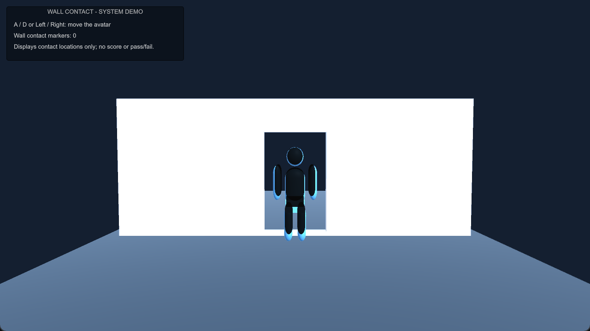
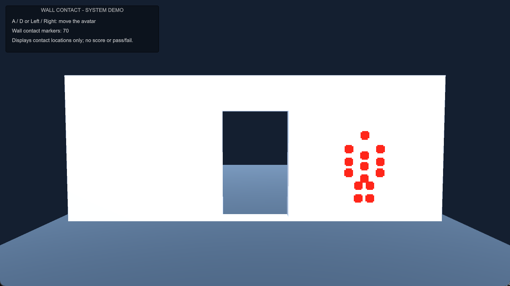

# 壁との接触位置・シルエット表示（Unity）

大学の共同制作ゲーム「迫りくる壁を避けろ！」で、自分が担当した部分をまとめたものです。
接触した位置や体の部位を確認する処理と、アバターの姿を壁に投影する処理を実装しました。

ゲーム全体のソースではありません。動作を確認しやすいように、Unity標準の図形だけで作ったデモシーンを追加しています。

## デモ画面

壁の穴とアバターの表示です。

壁に接触した位置を、赤いマーカーで表示しています。

## 動かし方

1. Unity Hubからこのフォルダーを開く（確認に使ったバージョン：**Unity 6 / 6000.3.14f1**）。
2. `Assets/Scenes/PoseWallDemo.unity` を開く。
3. Playボタンを押す。
4. **A / D** または **← / →** でアバターを左右に動かす。

壁が繰り返し近づき、アバターの位置に到達した時点で、接触しているサンプル点を赤いマーカーで表示します。
壁の手前にはアバターのシルエットも投影されます。SceneビューでGizmosを有効にすると、サンプル点も確認できます。

## 担当した実装

- Humanoidアバターの骨と骨の間に、複数の判定点を配置する
- 壁の形状に対して各判定点の接触を調べ、位置と部位を記録する
- 接触位置をGameビュー・Sceneビューで可視化する
- アバターのメッシュをもとに、壁面にシルエットを生成する
- 動いている壁の切り替えに合わせて、判定対象を更新する

## 実装で工夫したこと

体全体のメッシュで当たり判定を取ると処理が複雑になるので、Humanoidの骨と骨の間に点を置く方法にしました。腕や手先など、部位に合わせて判定点の大きさを調整できます。

ゲームの成功・失敗はここでは決めず、壁に触れた位置と体の部位だけを表示しています。どこまでをセーフにするかはチームで決まっていなかったので、まず接触状況を確認できるようにしました。

### 主なファイル

| ファイル | 内容 |
| --- | --- |
| `Assets/WallPassJudge.cs` | 骨のサンプリング、接触位置と部位の記録・表示 |
| `Assets/WallSilhouetteProjection.cs` | メッシュから壁面シルエットを作成 |
| `Assets/Resources/AvatarSilhouette.shader` | シルエット描画用シェーダー |
| `Assets/RandomWallLooper.cs` | 壁の移動と切り替え |
| `Assets/WallHoleDefinition.cs` | 穴の範囲を指定する補助コンポーネント |
| `Assets/Demo/DemoAvatarController.cs` | デモ用のキーボード操作と案内 |
| `Assets/Editor/PortfolioDemoSceneBuilder.cs` | Unity標準図形でデモシーンを作成・再生成 |

## デモと共同制作版の違い

- 共同制作版はHumanoidアバターの骨情報を使います。デモでは外部モデルを含めないため、簡易アバターに置いた固定サンプル点で同じ接触位置表示の流れを確認できます。
- **成功・失敗の判定や得点処理は含めていません。** どこまで接触を許容するかはチームでまだ決めていなかったため、接触した場所の確認までを担当しました。
- カメラによる姿勢推定、共同制作メンバーの3Dモデル、ゲーム全体の演出などは収録していません。

元のプロジェクトをそのまま転載したものではなく、担当部分と自作の最小デモをまとめたポートフォリオです。
